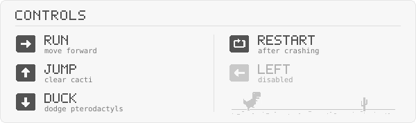

   
  <a href="https://github.com/ocld" title="back to game"><picture><source media="(prefers-color-scheme: dark)" srcset="./assets/buttons/back-banner-dark.svg"><source media="(prefers-color-scheme: light)" srcset="./assets/buttons/back-banner-light.svg"></picture></a>
    
  <picture><source media="(prefers-color-scheme: dark)" srcset="./assets/demo-dark.svg"><source media="(prefers-color-scheme: light)" srcset="./assets/demo-light.svg"></picture>
    
  <picture><source media="(prefers-color-scheme: dark)" srcset="./assets/controls-dark.svg"><source media="(prefers-color-scheme: light)" srcset="./assets/controls-light.svg"></picture>

